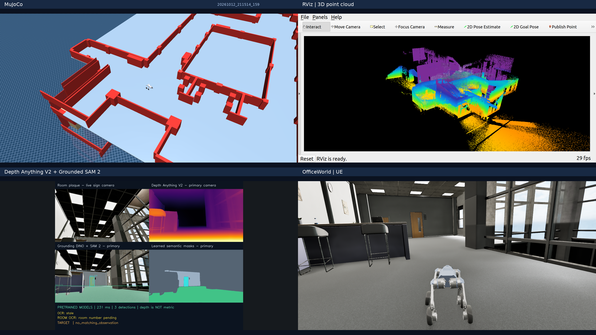

# WAVE-Go

**Go2-W Continuous Navigation · OfficeWorld · Colored 3D Point Clouds · Dynamic Obstacle Avoidance**

MuJoCo × Unreal Engine · ROS 2 Humble · MID-360 + IMU

[Run Guide](demos/office_mapping_20261002/docs/LOCAL_MACHINE.md) · [Latest Source](demos/office_mapping_20261002/runtime/) · [Validation Records](demos/office_mapping_20261002/evidence/2026-10-12/) · [Release Notes](demos/office_mapping_20261002/README.md)

Screenshot from the actual run on 2026-10-12: stopped at the second-floor doorway, with four synchronized windows. Room-number recognition remains unconfirmed; this image does not establish that SLAM accuracy has been validated.

## 2026-11-05 · Local Project Sync

Updated the existing OfficeWorld source overlay package and merged the previous mapping branch's content into the main branch. Previous commits, Wavegov1, V2, and older mapping materials are preserved. This update covered source backup and release checks; the robot was not restarted.

| Included in This Update | Details |
|---|---|
| Obstacle avoidance at the stair entrance | Adjusted the far-side turning area, flat-ground control parameters, and balance at zero velocity; added short reverse recovery constrained by live point-cloud checks |
| Live mapping | Native LIO data-processing fixes, dense colored point clouds, and route and inflation overlays supported by measured ground data |
| Continuous navigation | Smac A* / NavFn Dijkstra entry points, two moving pedestrians, stair and ramp ascent/descent, and a goal at the second-floor doorway |
| Experiment controls | Four-window startup, four-panel recording, separate screenshots, and WASD takeover after arrival |
| Traceability | Runtime source, parameters, scene XML, tests, source-file SHA-256 hashes, and raw validation JSON |

## Most Recent Complete Navigation Run

| 2026-10-12 · Smac A* | Result |
|---|---:|
| Stages completed continuously from the start | **15 / 15** |
| Navigation time | **376.301 s** |
| Distance to the doorway goal | **0.03667 m** |
| Final heading error | **4.842°** |
| Regression checks rerun for this release | **86 / 86** |

The original event sequence is 0–14. No pose resets occurred during the task, and separate continuation runs were not stitched together into a single full run. The newly added reverse recovery did not trigger during this complete run; the result validates the entrance turn, control parameters, and stable-standing strategy. Navigation uses simulation odometry, so **this does not validate native LIO accuracy or demonstrate successful room-number recognition**. [Full Record and Limitations](demos/office_mapping_20261002/runtime/docs/LOCAL_ESCAPE_20261012.md)

## Download and Run

~~~bash
git clone https://github.com/vigorlee/wave-go.git
cd wave-go/demos/office_mapping_20261002
python3 install_snapshot.py
~~~

If the local MATRiX / RoamerX runtime environment is already available:

~~~bash
cd /home/unitree/Go2w+cosmos3Nav/matrix_go2w_office_20260916
unset OFFICE_PREPARE_GATE OFFICE_START_STAGE INLINE_START_X INLINE_START_Y INLINE_START_YAW
OFFICE_LIO_EXECUTABLE="$PWD/.run/go2w/native_lio_build/mapping" OFFICE_RECORD=1 bash scripts/start_office_global_auto.sh SmacAStar
~~~

On a new computer, prepare the scene package, model weights, and ROS workspace first. GitHub provides a source overlay package; these large runtime resources are not bundled. [Restore, Build, Record, and Control Manually](demos/office_mapping_20261002/docs/LOCAL_MACHINE.md)

## Other Entry Points and Historical Materials

| Entry Point | Purpose |
|---|---|
| [Current OfficeWorld Release](demos/office_mapping_20261002/README.md) | Navigation, mapping, and the four-window demo included in this update |
| [Saved Map Replay](demos/office_mapping_20261002/scripts/replay_map.sh) | View the October 1 static point cloud already in the repository, independently of the current live task |
| [FAST-LIO / Adaptive Voxel V2](demos/WavegoV2/README.md) | Standalone mapping and grid visualization |
| [Chinese-Language Semantics and Graph](demos/semantic_hierarchy/README.md) | Previously released semantic hierarchy viewer |
| [Wavegov1](demos/Wavegov1/README.md) | Historical stable version |
| [October 2 Mapping Overview](README_MAPPING_20261002.md) | Historical images, parameters, and earlier run records for both planners |

Original videos remain on the local machine. The repository includes their source paths, SHA-256 hashes, decode checks, and screenshots. PCD files, rosbags, virtual environments, build caches, and other research directories are not included in this source update.
