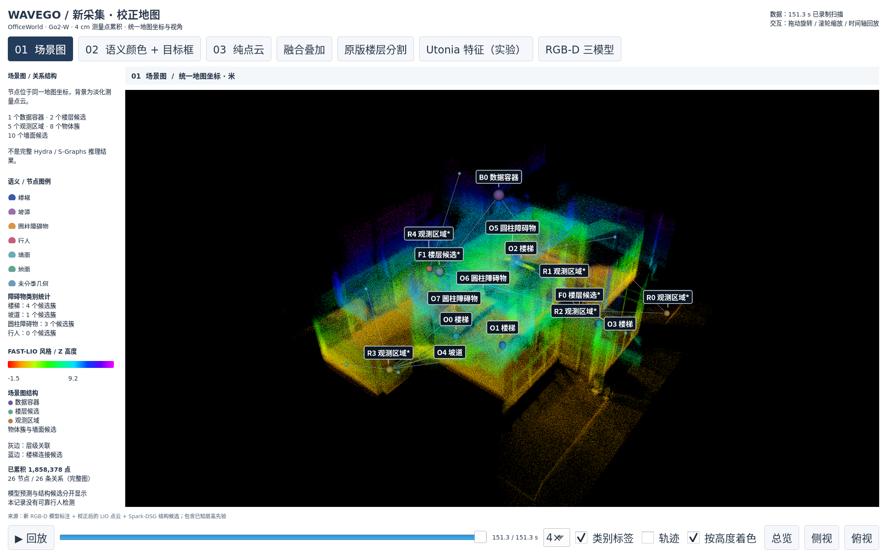
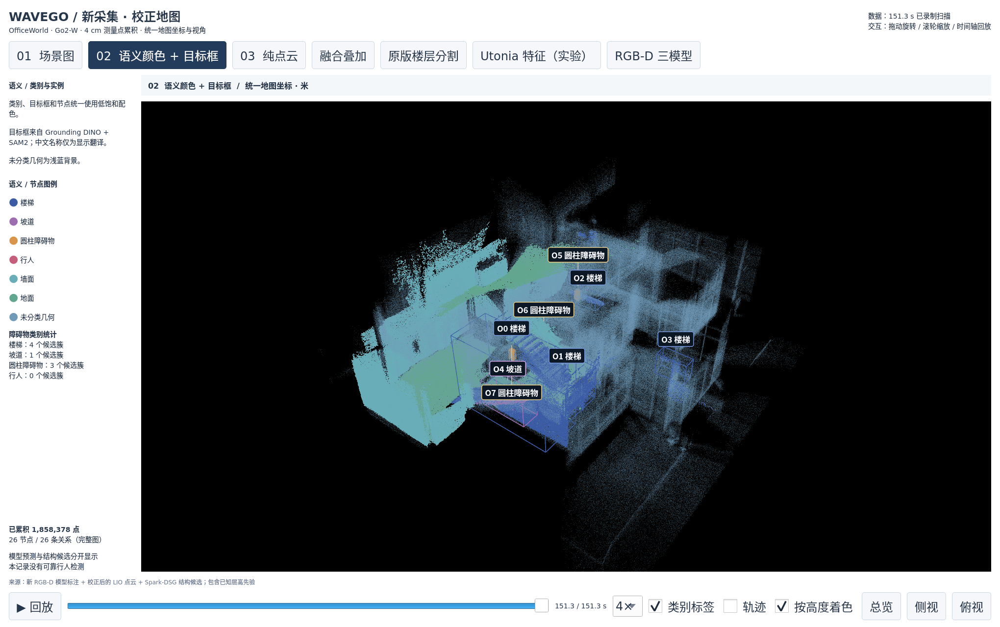
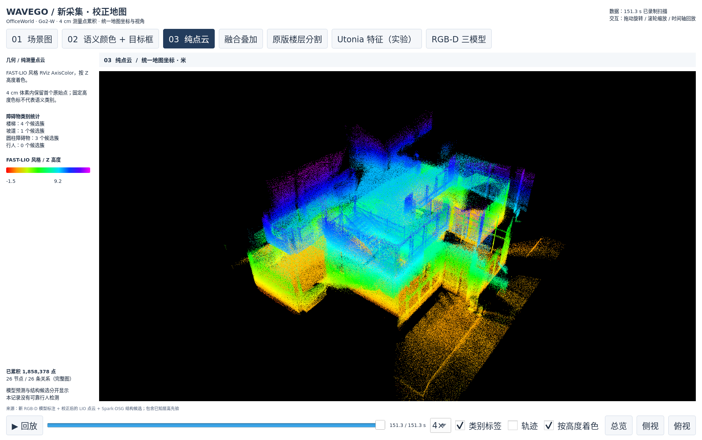
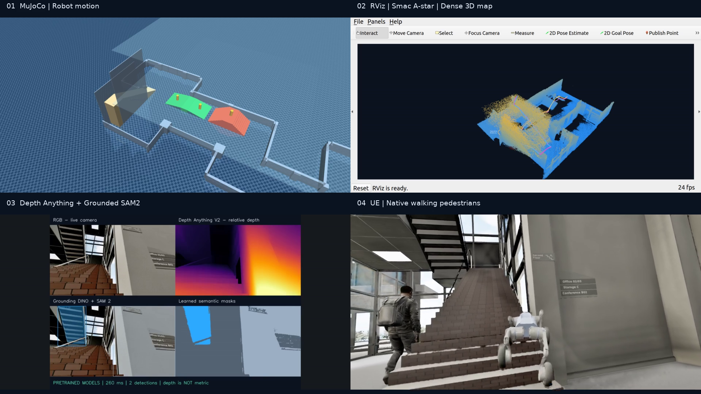
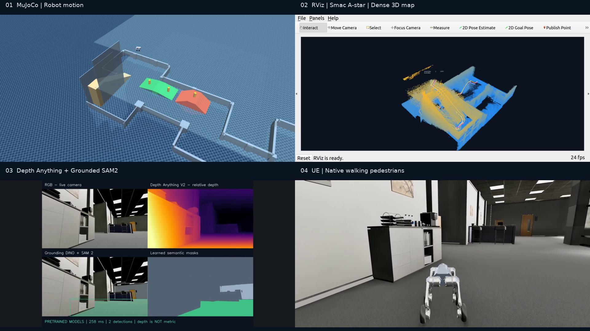

<div align="center">

# WAVE-Go

**Go2-W 轮足导航 · 三维点云建图 · 语义与场景图**

MATRiX / OfficeWorld · MuJoCo × UE · MID-360 + IMU

[最新建图](demos/office_mapping_20261002/README.md) · [仿真截图说明](demos/office_mapping_20261002/evidence/README.md) · [本机启动](demos/office_mapping_20261002/docs/LOCAL_MACHINE.md) · [中文语义窗口](demos/semantic_hierarchy/README.md)

</div>


<p align="center"><sub>2026-10-01 Smac A* 仿真第 48.343 秒。四分屏同时显示 MuJoCo 运动、RViz 建图、RGB-D 模型与 UE 原生行人。</sub></p>

## 最新分支：mapping-20261002

从这台电脑的实际运行工程整理 **10 月 2 日建图源码**、两轮完整仿真证据、启动脚本与压缩测点。旧版 V2、Wavegov1、中文 Box / Graph 查看器和历史资料继续保留。

| 内容 | 本分支包含 |
|---|---|
| 连续导航 | 大楼梯、斜坡、圆柱、两名行人、原生楼梯到二楼；NavFn Dijkstra / Smac 2D A* |
| 点云建图 | LiDAR/IMU 前端、原生 ikd-Tree 地图出口、全高度地图与可选剖切 |
| 密度与膨胀 | 最新实时显示 2.5 cm 体素；点云距离场和自适应膨胀分析 |
| 语义表示 | DINO + SAM2 标签、公制深度投影、中文 Box、Graph、纯点云和融合视图 |
| 可复核资料 | 源文件 SHA-256、原截图与视频时间点、历史运行报告、3 cm 压缩点云/轨迹 |

**数据版本分开说明**：10 月 1 日保存点云为 3 cm；今天代码默认 2.5 cm。9 月中文场景图使用旧校正记录。体素大小不是绝对测绘精度，不同记录没有被当作同一份地图。

## 下载后先看地图

```bash
git clone --branch mapping-20261002 https://github.com/vigorlee/wave-go.git
cd wave-go/demos/office_mapping_20261002

python3 install_snapshot.py          # 核对源码、点云和证据文件
bash scripts/replay_map.sh --check   # 读取随附地图并打印点数
bash scripts/replay_map.sh --side    # 打开保存地图的 RViz2 可视化
```

查看地图需要 Ubuntu 22.04 / ROS 2 Humble、NumPy、SciPy、`sensor_msgs_py` 和 RViz2。随附点云包含 **3,316,238 个**记录测点，场景区域显示 **2,410,731 个**。该入口是保存数据的静态回放，不启动机器狗。

完整仿真另需 MATRiX OfficeWorld 资源、RoamerX、DreamWaQ 与视觉模型权重。[启动、编译与停止命令](demos/office_mapping_20261002/docs/LOCAL_MACHINE.md)说明如何在本机运行，以及如何将源码覆盖包恢复到已准备的运行工程。

## 建图结果


三幅图使用同一次保存的 LIO 测点：完整高度俯视、为查看楼梯/坡道而设置的建筑剖切、中央走廊高度剖面。颜色表示高度；图中的球和连线是抽样 LIO 位姿。原生 ikd-Tree 出口另用旧 bag 做了独立回放核验，见 [原生地图结果](demos/office_mapping_20261002/evidence/mapping/native_ikd_map.png)。

### 同一窗口：Graph、语义 Box、纯点云

| 场景图 | 中文语义与 Box | 纯点云 |
|---|---|---|
|  |  |  |

这组截图来自 9 月校正地图，三种表示共用 **1,858,378 点**。中文类别在目标框旁显示，移除了末尾问号；地图内嵌在控制面板中。保留 HOV-SG 楼层模块、Utonia 特征与 RGB-D 三模型结果入口。代码、数据准备和本机运行见 [语义建图 README](demos/semantic_hierarchy/README.md)。

## 两轮连续导航实录

| 2026-10-01 | 阶段完成 | 导航耗时 | 等待 / 恢复 |
|---|---:|---:|---:|
| NavFn Dijkstra | 12 / 12 | 160.186 s | 3 / 3 |
| Smac 2D A* | 12 / 12 | 156.637 s | 3 / 3 |

| 楼梯阶段 | 二楼终点阶段 |
|---|---|
|  |  |

六张导航关键帧均附原视频路径与时间点，见 [截图与验证说明](demos/office_mapping_20261002/evidence/README.md)。这是两次完成任务的仿真记录，不作为两种规划器的统计性能结论。本次发布没有把 10 月 2 日的代码改动宣称为重新通过了这两次完整运动测试。

## 选择入口

| 需求 | 文档 |
|---|---|
| 最新 OfficeWorld 建图、两种规划与原生行人 | [2026-10-02 快照](demos/office_mapping_20261002/README.md) |
| 中文 Box / Graph / 纯点云与旧校正地图 | [语义层级地图](demos/semantic_hierarchy/README.md) |
| FAST-LIO 与密度自适应三维栅格 | [V2](demos/WavegoV2/README.md) |
| 导入 LAZ、去顶、楼梯几何与局部拼接 | [实测点云处理](demos/semantic_hierarchy/docs/z5_feature_detection.md) |
| v1 实时语义导航 | [Wavegov1](demos/Wavegov1/README.md) |
| 早期三类障碍与 Cosmos 高层路线选择 | [历史导航](demos/go2w-cosmos-extended-navigation/README.md) |
| 无图充电视觉搜索 | [独立实验](README_MAPLESS_CHARGER_SEARCH.md) |

## 实现范围

本页运动结果来自 **MuJoCo / UE 仿真**。最新导航使用场景几何构建分层二维可通行区，再由 Nav2 求解；地形转换与 RL 控制负责爬楼。动态等待依据当前 LiDAR 几何簇，不等同于已验证的人体语义识别或无图探索。

LIO 地图、视觉语义、几何候选和位姿节点图各有独立来源。当前尚未完成回环或绝对地图精度验证，也未运行完整 Hydra、S-Graphs 或 Elevator-LIO 全链路。数据来源、上游版本和保留依赖见 [详细说明](demos/office_mapping_20261002/docs/SOURCE_AND_LIMITATIONS.md)。

[本次校验](demos/office_mapping_20261002/docs/VALIDATION.md) · [旧版首页及历史 Release](README_HISTORY_20260922.md) · [源文件与数据清单](demos/office_mapping_20261002/source_manifest.json)
