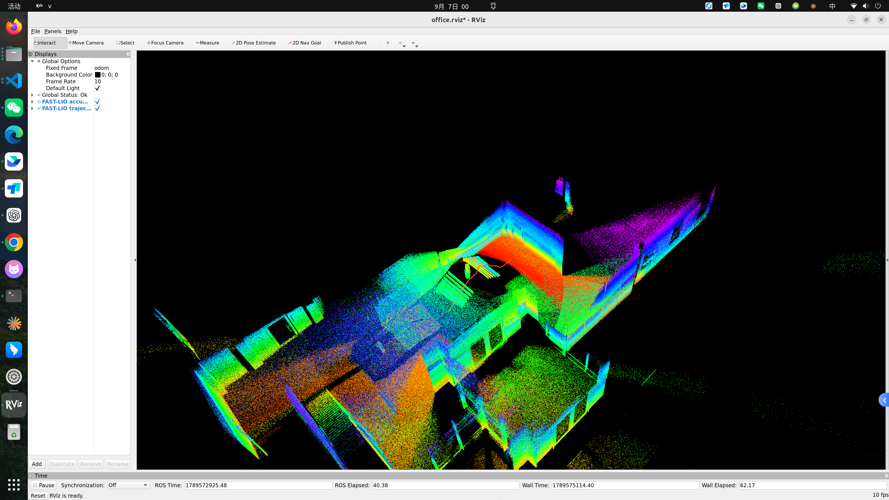
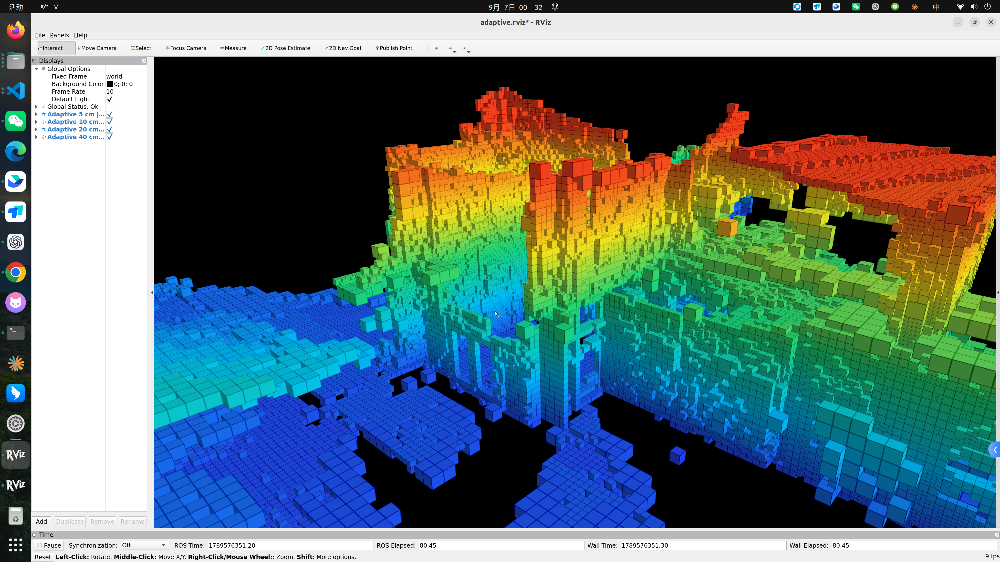

# Wavego V2 · 点云建图与自适应三维栅格

V2 保存两套可启动的建图可视化：**FAST-LIO 点云＋轨迹**、**按点云密度自适应的三维体素地图**。默认恢复为完整场景的自适应栅格全景，不使用楼梯裁剪近景。

| FAST-LIO 点云建图 | 自适应三维栅格 |
| --- | --- |
|  |  |

## 1. 下载、安装与编译

面向 Ubuntu 22.04、x86_64、有桌面显示的 Linux。安装 Git 和 Miniconda；需要网络下载 ROS Noetic/编译依赖及 Livox SDK2。首次安装需要数 GB 磁盘空间。

```bash
git clone --branch V2 https://github.com/vigorlee/wave-go.git
cd wave-go/demos/WavegoV2
bash scripts/bootstrap.sh
bash scripts/build.sh
```

依赖安装在本目录 `.runtime/noetic`；不会替换系统 ROS 2。SDK 固定到 `08f523c930b2f0ba1e98a6afaa8d7476bf479908`。环境包含 `empy=3.3.4`、`cmake<4`、GTSAM、NumPy、SciPy、PCL、RViz 与 ROS Noetic。安装方法参考 [RoboStack](https://robostack.github.io/conda.html)。

本机已安装环境的快捷启动见 [LOCAL_MACHINE.md](docs/LOCAL_MACHINE.md)，无需重复下载。

## 2. 启动 FAST-LIO 点云建图

```bash
bash scripts/start_fastlio.sh --bag /absolute/path/go2w_pointcloud_odom_noetic.bag
```

启动独立 ROS master（端口 **11321**）、PointCloud2 适配节点、FAST-LIO、RViz 和 rosbag 回放。默认 0.7 倍速；可加 `--rate 1.0`。可加 `--port 12321` 避开其他会话。

输入要求：ROS 1 `.bag`，包含以下话题与字段：

| 输入 | 用途 |
| --- | --- |
| `/livox/lidar_raw` · PointCloud2 | 仿真点云；x/y/z/intensity 为 float32，line 为 uint8；具体布局见适配脚本 |
| `/imu/data_raw` · Imu | 与此 OfficeWorld 外参对应的 IMU |

适配节点将原始坐标转换为 FAST-LIO 支持的 PointCloud2 字段结构，并过滤非有限值和 35 米外点。这里选择 Ouster 格式的读取路径只是格式兼容，不表示改用了 Ouster 雷达。源点云逐点时间为零，保留零偏移；没有伪造扫描时间。

FAST-LIO 的输出：`/cloud_registered`、`/Odometry`、`/path`；RViz 固定坐标系 `odom`。使用点云和 IMU 重新估计位姿，不使用 bag 里的里程计来摆放点云。RViz 的长时间累积显示不是回环优化后的全局地图。

配置：[fastlio_office.yaml](config/fastlio_office.yaml)。不同传感器需修改外参、IMU 和点云适配，不能只替换话题名就保证正确。

**本仓库未包含 2.3 GiB 的原始 bag**。本机已有文件的路径见快捷说明；其他电脑需复制 bag 或准备满足输入格式的数据。示例 PCD 已随代码提供，下面的栅格 demo 不需要 bag。

## 3. 启动三维自适应栅格

```bash
# 使用仓库自带的 OfficeWorld PCD
bash scripts/start_grid.sh

# 使用自己的 PCD
bash scripts/start_grid.sh /absolute/path/map.pcd
```

支持本版本的二进制 XYZ PCD（`FIELDS x y z`，三个 float32）。启动独立 ROS master（端口 **11322**），先离线计算占据体素，再在 RViz 显示；不是实时新增点云的在线栅格更新。

- 用第 8 近邻距离估计密度，选择 **5 / 10 / 20 / 40 cm** 栅格。
- 稀疏区域适当放大，稠密区域保留细节；各层互不重叠，每个输入点恰好落入一个占据体素。
- 所有尺寸共用高度颜色：**蓝 → 青 → 绿 → 黄 → 红**，分别对应从低到高。
- 色标范围取源点云高度的第 1、99 百分位，超出范围使用端点色。示例约 -0.856 至 7.171 m。
- 可在左侧单独开关四个分辨率图层，鼠标拖动旋转、滚轮缩放。

示例源文件有 292652 个点，生成 160731 个体素。输出位于 `.run/grid/adaptive_voxels.npz` 和 `report.json`，包含中心、尺寸、点数支持和颜色。

该方法减少采样间隙，不补造未扫描表面；较大体素可能收窄窄缝，尚未验证作为机器人导航碰撞地图使用。示例原地图已有配准误差和降采样，显示参数不能恢复丢失信息。

## 4. 停止、日志与常见问题

在启动终端按 **Ctrl+C**；启动器会关闭自己创建的子进程，不停止其他 ROS 会话。回放结束保持最后画面。两个 demo 可在不同终端同时运行。

- 日志：`.run/fastlio/`、`.run/grid/`。
- 端口占用：先结束旧 demo，或加 `--port 12321` / `--port 12322`。
- 无图形桌面：加 `--no-rviz` 仅验证计算和话题，RViz 需要有效 `DISPLAY` 与桌面权限。
- 找不到环境：先运行 bootstrap；已有环境用 `WAVEGO_V2_ENV` 指定。
- 调整栅格算法：`scripts/build_adaptive_voxels.py`；显示配置：`config/adaptive_grid.rviz`。

## 5. 代码范围、来源与验证

这里是两套建图功能的完整工作空间源码，包含 `fast_lio`、`livox_ros_driver2`、`map_generator` 三个项目包（catkin 构建还会生成一个 prebuild 包）。不包含与本任务无关的飞控、飞行器模型、历史地图、虚拟环境及编译产物。原有 Wavego v1 和导航内容保留在仓库其他目录。

保留上游 LICENSE 与说明；新增适配/显示脚本来自本次本机工程整理。Livox SDK2 由构建脚本按固定提交获取。本版源自 `/home/unitree/flycar` 已编译工作的代码，修复了消息生成依赖、包内头文件路径、SDK 查找等构建问题。

`map_generator/random_forest` 保留可用的 `~pcd_path` 参数及 PCD 发布功能；默认 V2 的自适应处理直接读取同一 PCD，完整实现保存在该包 scripts 目录。此处未把新增 Python 栅格处理冒充为原包自带的 SDF 算法。

示例 PCD 是此前 OfficeWorld 在线地图的快照；两张截图分别展示各自功能，不代表同一套估计器同一时刻的对齐结果。

验证详情见 [VALIDATION.md](docs/VALIDATION.md)。原版回退可切换仓库原有分支；V2 不覆盖 `main` 或冻结分支。
