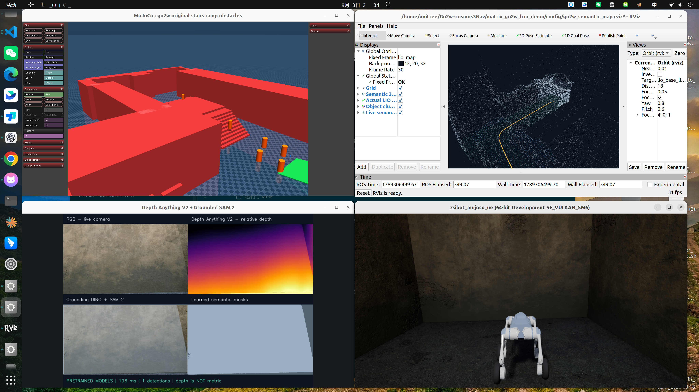
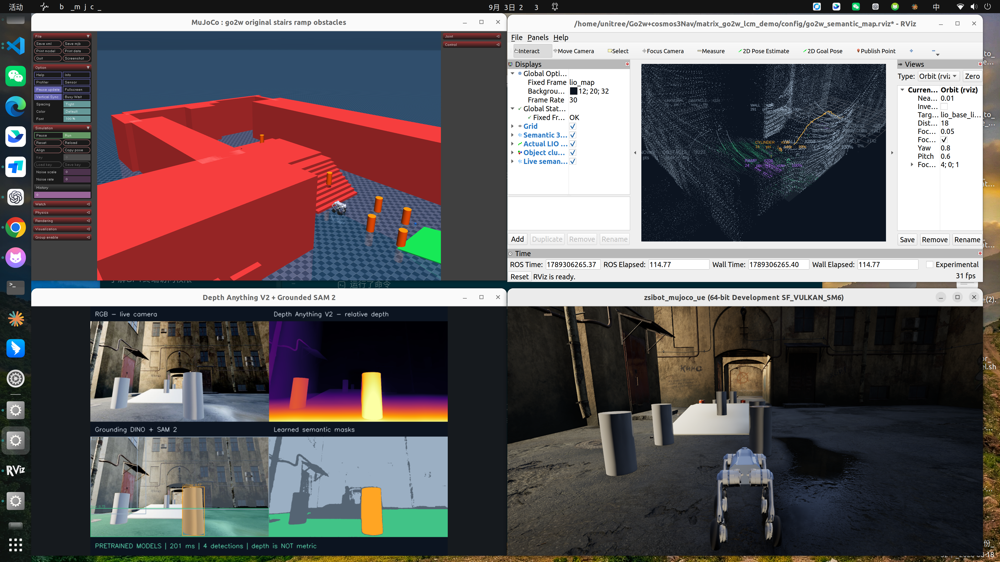

<div align="center">

# Wave-Go v1 · 三维语义地图

**实时建图 · 物体聚类 · 行人标签 · Cosmos 连续穿障**

[运行与算法说明](runtime/README_SEMANTIC_V1_CN.md) · [实测证据](evidence/semantic_v1/) · [下载 v1](https://github.com/vigorlee/wave-go/releases/tag/v1) · [旧基线](README_BASELINE.md)

</div>


在真实雷达测量形成的 LIO 地图上，叠加 Grounding DINO + SAM2 类别与三维物体簇。行人用粉色短时显示，楼梯蓝色、坡道紫色、圆柱橙色；灰色区域保持未知。保存 PCD、NPZ、物体 JSON 和实际导航轨迹。

## 验收与边界

最终完整复跑 **19/19 通过、1 次连续 Nav2 动作**，用时 **278.3 秒**，抵达东侧角落 `(18.041, 23.039)`，距目标 **0.24 m**。上坡实际升高 **44.4 cm**，下坡验证通过。语义节点全程未重启；形成 **21 次**三维行人簇更新。这是成功运行记录，不代表长期识别准确率。

[验收汇总](evidence/semantic_v1/acceptance.json) · [完整导航结果](evidence/semantic_v1/course/result.json) · [地图 PCD](evidence/semantic_v1/semantic_map.pcd) · [地图 NPZ](evidence/semantic_v1/semantic_map.npz)




本轮测量 MID360 **10.00 Hz**，实时语义点云 **2.00 Hz**，完整语义地图约 **0.30 Hz**。[ROS 输入来源及刷新审计](evidence/semantic_v1/ros_audit.json)确认建图与语义使用 LIO 位姿；不订阅 MuJoCo 真值位姿。**85 项测试通过**。

12 cm 是体素分辨率，尚未测量绝对地图精度；没有闭环校正，模型仍有误检、漏检。新语义簇用于显示与导出，未直接替换原有避障控制。导航仍使用历史必经路线与已知地图，不能称为纯无图探索。详见[算法、类别和限制](runtime/README_SEMANTIC_V1_CN.md)。



## 运行

已配置工作站：

```bash
cd /home/unitree/matrix_go2w_lcm_demo
bash scripts/start_go2w_semantic_v1.sh
```

只启动实时显示：`GO2W_SEMANTIC_PREVIEW_ONLY=1 bash scripts/start_go2w_semantic_v1.sh`。

恢复到一套准备好的 MATRiX / RoamerX 工作区：

```bash
python3 demos/Wavegov1/install_snapshot.py --runtime /path/to/matrix_go2w_lcm_demo
# 停止该工作区的仿真、建图、语义服务后应用覆盖层
python3 demos/Wavegov1/install_snapshot.py --runtime /path/to/matrix_go2w_lcm_demo --apply
```

应用后重新编译控制桥和 `robot_slam`：

```bash
cd /path/to/matrix_go2w_lcm_demo
bash scripts/build_demo.sh
source /opt/ros/humble/setup.bash
cd genisom_roamerx_open
colcon build --packages-select robot_slam --cmake-args -DCMAKE_BUILD_TYPE=Release
```

本仓库保存源码覆盖层，不包含 MATRiX UE 大型资源、模型权重或整个 ROS 安装。依赖见 [snapshot.json](snapshot.json) 和[基线安装说明](README_BASELINE.md)。默认 Cosmos 环境位于 `/home/unitree/matrix_g1_lcm_demo/packages/cosmos-framework`，检查点位于 `/home/unitree/matrix_g1_lcm_demo/Cosmos3-Edge`；其他机器需配置对应环境与路径。纯显示模式不需要 Cosmos 推理。

新 `v1` 取代当前版本入口；历史 `Wavegov1-baseline` 标签保留用于回退。
