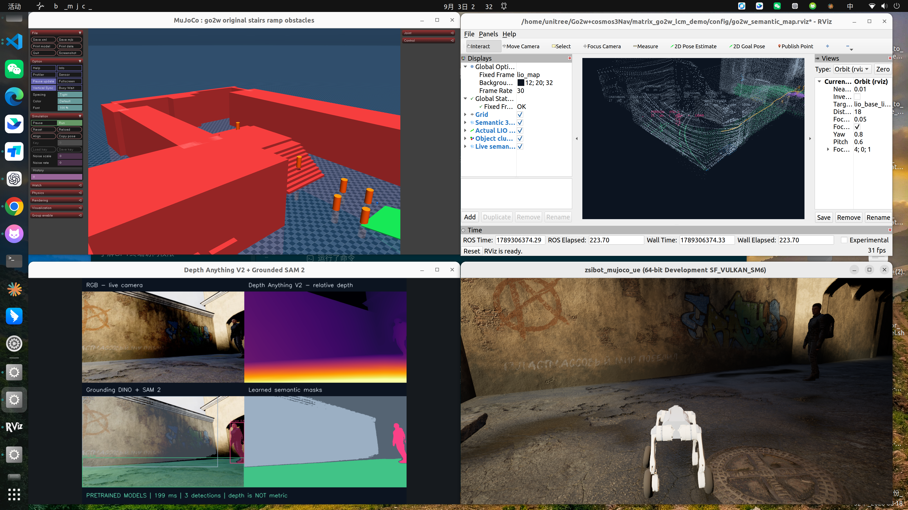

# Wave-Go v1 · 实时三维语义地图

**MID360 / LIO 建图 → DINO + SAM2 语义 → 点云聚类 → RViz 类别、包围框与物体编号。**

在原楼梯、圆柱与上下坡场景上增加语义处理，不增加地形。默认让 Cosmos 选择完整必经任务，并连续穿越北侧长廊到东侧角落 `(18, 22.8)`。新版替代此前 v1 入口，旧版仍可通过 `Wavegov1-baseline` 标签恢复。

## 启动

已配置 MATRiX、ROS 2 Humble、RoamerX 和模型权重的工作站：

```bash
cd /home/unitree/matrix_go2w_lcm_demo
bash scripts/start_go2w_semantic_v1.sh
```

只看实时语义建图，机器人保持原地：

```bash
GO2W_SEMANTIC_PREVIEW_ONLY=1 bash scripts/start_go2w_semantic_v1.sh
```

启动会重置仿真。保持 UE 窗口开启；关闭窗口会停止模拟器及导航。四窗口为 MuJoCo、UE、RViz、Depth Anything V2 / Grounding DINO / SAM2。

## RViz 中新增的内容

| 图层 | 内容 | 话题 |
|---|---|---|
| Semantic 3D map | 累积雷达几何，按语义着色 | `/wavego/semantic/map` |
| Live semantic obstacles | 当前扫描的语义点云；行人在此实时更新 | `/wavego/semantic/live_points` |
| Object clusters and semantic labels | 密度聚类、三维包围框、类别与跟踪编号 | `/wavego/semantic/objects` |
| Actual LIO trajectory | 雷达惯性里程计实测轨迹 | `/wavego/mapping/trajectory` |

颜色：楼梯蓝、坡道紫、圆柱橙、行人粉、墙面浅灰、地面青绿、未知深灰、楼梯/坡道歧义黄。关闭的是 UE 绿色扫描调试点；地面的绿色是语义类别颜色。

标签包含 `PERSON / CYLINDER / STAIRS / RAMP / WALL / UNKNOWN OBSTACLE` 与物体编号。`vote` 是空间体素的跨帧类别一致性，**不是识别准确率或模型置信度**。行人显示 `vision + LiDAR`，不把直接关联写成 100% 置信度。编号是局部近邻跟踪 ID，遮挡或间隔过长后可能改变。

## 算法与数据来源

1. **几何**：MID360 实际射线点云 + IMU → 本机 FAST-LIO 系列 `robot_slam` → 注册点云与累积地图。未把用于导航的人工障碍融合点云接入语义建图。
2. **视觉语义**：已有 Grounding DINO Tiny 检测 + SAM 2.1 Hiera Tiny 掩膜，保留类别阈值、两帧确认和掩膜质量过滤。
3. **三维对齐**：同步的 UE 米制深度将掩膜反投影，通过 **LIO** 机身位姿变换到 `lio_map`。RGB/深度时间差 < 150 ms，深度/位姿差 < 100 ms；语义节点拒绝坐标系错误或输入年龄 > 1 s 的帧。
4. **标签融合**：12 cm 语义体素，每帧每体素一票；至少 3 个不同时间戳，类别票占比 ≥ 60%，关联到 18 cm 内的实际雷达点。未匹配点保持未知，不根据场景坐标指定类别。
5. **物体聚类**：局部最低高度包络移除平地，每个语义类别分别进行 KD-tree DBSCAN（邻域 32 cm，核心点至少 5，簇至少 12 个降采样点）。显示机器人周围 12 m、高度差 −1.5～2.5 m 的物体；最多显示 16 个标签，优先已识别类，减少遮挡。
6. **动态处理**：行人只在时间差 ≤ 0.8 s 的实时扫描里赋类，轨迹确认至少 3 次；失去观测后标签消失。已识别行人的占用体素从静态输出中排除。未识别的运动物体仍可能留下点云残影，排除区域也可能产生局部空洞。

Depth Anything V2 仍提供相对深度辅助画面，**没有当作米制测距**。导航使用已验证路线、原地图和 MuJoCo 位姿；它与独立 LIO 语义建图分开，因此这版导航不是纯无图探索。

## 精度与适用范围

这是带物体标签的在线三维语义地图原型。12 cm 是体素分辨率，18 cm 是匹配门限，均不等于绝对地图误差。尚无闭环校正、测量基准精度评估或人工标注的语义 IoU / 行人精确率评估，不能声明厘米级高精地图。墙面可能被 DINO 误检为楼梯，跨帧一致性不能消除持续误检；低置信度和视野外区域保持未知。

聚类目前用于可视化与导出，**没有把新语义标签直接接管避障控制**；导航仍保留既有局部避障。整体工程不等同于安装了 ConceptGraphs、Hydra 或 Super-LIO。

## 保存与复现

输出到 `artifacts/semantic_v1_时间/`，可以通过 `COSMOS_VLN_ARTIFACT_DIR` 指定。

| 文件 | 用途 |
|---|---|
| `semantic/semantic_map.pcd` | 二进制 PCD，字段 `x y z rgb label`，坐标单位米 |
| `semantic/semantic_map.npz` | 点与类别数组，便于 Python 分析 |
| `semantic/objects.json` | 当前物体、尺寸、ID、点数和观测时间 |
| `semantic/events.jsonl` | 连续处理记录，包括类别簇数、过期状态和耗时 |
| `semantic/person_*/` 等 | 实际识别到该类别时的雷达点云及物体记录 |
| `course/result.json` / `odom.csv` | 连续穿障完成状态和实际运动轨迹 |
| `anything/frames.jsonl` | 模型原始检测、过滤原因、时序与语义像素统计 |
| `mapping/` | 独立原始 LIO 点云地图与轨迹 |

当前内存会话的标签在语义节点重启后重新积累；已保存 PCD / NPZ 是离线地图，不自动跨会话拼接，以免不同 LIO 原点错位。

```bash
source /opt/ros/humble/setup.bash
source genisom_roamerx_open/install/setup.bash
.venv-anything/bin/python -m unittest discover -s tests -q
```

## 开源方案检索（2026-09-13）

- [Grounded SAM 2 官方仓库](https://github.com/IDEA-Research/Grounded-SAM-2)：文本检测与实例掩膜；本机沿用已有 Transformers 模型实现。
- [Open3D 点云聚类说明](https://www.open3d.org/docs/release/tutorial/geometry/pointcloud.html)：DBSCAN 的邻域和密度参数；本版采用 SciPy KD-tree 实现，避免引入额外图形依赖。
- [ConceptGraphs 官方仓库](https://github.com/concept-graphs/concept-graphs)：开放词汇物体级地图参考，尚未集成。
- [Hydra 官方仓库](https://github.com/MIT-SPARK/Hydra)：在线三维场景图参考，尚未集成。

## 最终实测（2026-09-13）

`artifacts/semantic_v1_final`：**19/19 阶段通过，1 次连续导航动作，278.35 秒**，到达 `(18.041, 23.039)`，距任务目标约 0.24 m；该距离是导航终点误差，不是地图精度。坡顶升高 44.44 cm，楼梯最高机身高度 2.049 m。

语义节点全程未重启，产生 21 次三维行人簇更新；保存地图约 15.35 万点。独立 ROS 审计测得原始扫描 10.00 Hz、语义扫描 2.00 Hz、累积语义地图 0.30 Hz。85 项测试通过。原始记录见 `acceptance.json`、`ros_audit.json` 和实际类别点云样本。


