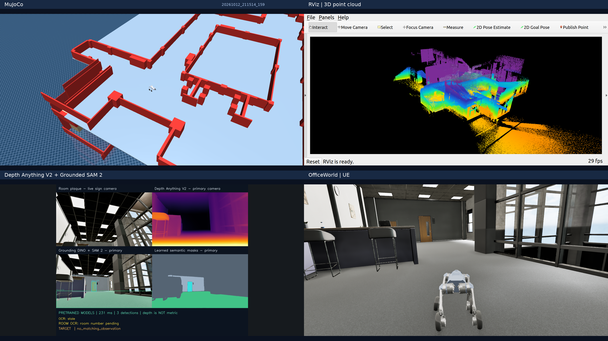

# OfficeWorld · Go2-W 连续导航与三维建图

**2026-11-05 源码同步**，目录名沿用首次发布日期，以保留已有链接。当前包含本机 OfficeWorld 工程的导航、LIO、彩色点云、膨胀、门目标与四窗口操作代码。

[启动与恢复](docs/LOCAL_MACHINE.md) · [发布检查](docs/VALIDATION.md) · [来源与限制](docs/SOURCE_AND_LIMITATIONS.md) · [源码清单](source_manifest.json)

## 本次更新

- 楼梯入口先进入远侧转向区域，再对准楼梯；平地速度参数支持实际转向，零指令由原有策略保持平衡。
- 连续等待时允许有限后退，但必须通过新鲜点云、场景几何、行人预测及实际位移检查。正常前进行人避让距离保持不变。
- 保存原生 LIO 的点处理与状态初始化修复，以及项目内独立构建脚本。全高度彩色实测点云默认使用 3 cm 体素、至少两次观测；采样分辨率不代表地图绝对精度。
- 路线与膨胀显示使用实测地面支撑，保留四窗口、录制、截图、房号识别接口和 WASD 接管。

具体修改见 [2026-10-12 局部避障记录](runtime/docs/LOCAL_ESCAPE_20261012.md)。[历史房号识别记录](runtime/docs/DOOR_RECOGNITION_20261002.md)属于不同运行，不能替代本次导航的房号核验。

## 验证来源

最近完整运行是 **2026-10-12 的 Smac A***：从起点完成 15/15，376.301 s，到目标 0.03667 m，航向误差 4.842°。本次 2026-11-05 发布在打包后的源码上重新执行 86 项入口、恢复及显示回归检查，未重跑仿真。

[完整运行结果](evidence/2026-10-12/course/result.json) · [事件流](evidence/2026-10-12/course/events.jsonl) · [验证摘要](evidence/2026-10-12/local_escape_navigation_validation.json) · [本次发布检查](evidence/publication_20261105/regression.json)

该完整运行没有触发新增后退恢复；不能据此宣称全部恢复动作已实景通过。房号未确认，原生 LIO 上楼精度仍待独立验证。几何行人候选不等于神经网络确认的人类标签。

## 快速开始

~~~bash
git clone https://github.com/vigorlee/wave-go.git
cd wave-go/demos/office_mapping_20261002
python3 install_snapshot.py

# 仅比较已准备的运行工程；不覆盖文件
python3 install_snapshot.py --runtime /path/to/prepared-runtime
~~~

需要恢复源码时，先停止相关仿真，给最后一条命令增加 --apply。安装器先备份差异，然后复制源码；大型运行资源需已存在。[本机完整指令](docs/LOCAL_MACHINE.md)

仍可查看此前随仓库保存的静态地图：

~~~bash
bash scripts/replay_map.sh --check
bash scripts/replay_map.sh --side
~~~

这里回放的是 **2026-10-01 已保存点云**，不是启动在线导航或重建本次地图。其数据来源与旧规划结果见 [10 月 2 日说明](docs/history_20261002/README.md)和[历史截图说明](evidence/README.md)。

## 目录

~~~text
runtime/                  当前运行源码、场景覆盖层、参数、测试和本地说明
evidence/2026-10-12/       实际完整运行的 JSON、事件流、原始截图和视频来源
evidence/publication_20261105/  本次发布检查
source_manifest.json      文件来源、字节数、源与打包 SHA-256
data/                     此前随仓库发布的静态压缩点云
install_snapshot.py       核验与可选的备份式恢复
~~~

原始 MP4、PCD/rosbag、场景安装包、模型权重、虚拟环境、编译产物和其他会话的研究项目不包含在本次更新中；本机原文件未修改或删除。
