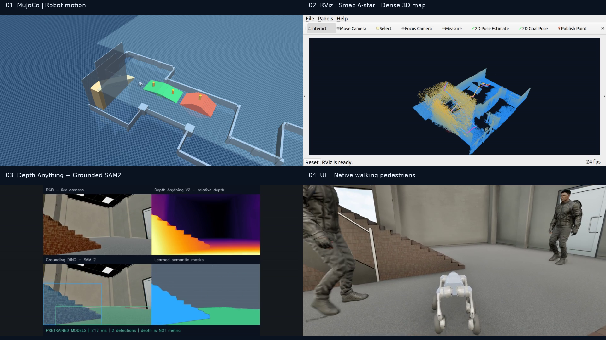
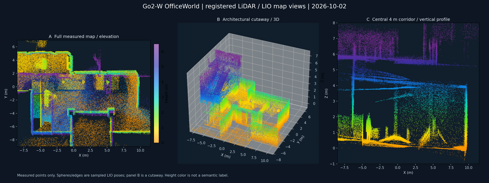
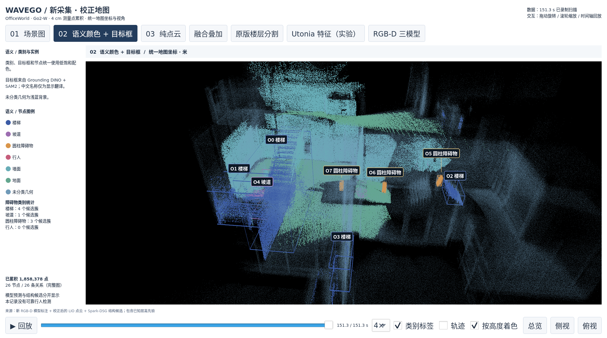

# OfficeWorld · Go2-W 连续导航与三维建图

**2026-10-02 本机源码快照**：MID-360 + IMU、原生 LIO / ikd-Tree 地图、实时稠密点云、视觉语义叠加与动态行人等待。包含两种 Nav2 全局规划器完成全程的仿真证据，以及下载后即可检查的压缩点云。

[截图与时间点](evidence/README.md) · [本机启动](docs/LOCAL_MACHINE.md) · [来源与实现范围](docs/SOURCE_AND_LIMITATIONS.md) · [本次校验](docs/VALIDATION.md)



2026-10-01 Smac A* 运行第 **48.343 s** 的四分屏：左上 MuJoCo 机器人状态，右上 RViz 地图与路线，左下 Depth Anything V2 / Grounding DINO / SAM2，右下 UE 场景和两名原生行人。它是已录视频的关键帧，不是本次重新跑出的结果。

## 先看地图：不需要完整仿真资源

Ubuntu 22.04、ROS 2 Humble，Python 3 的 NumPy / SciPy，以及 `sensor_msgs_py`；图形显示还需要 RViz2 和可用桌面。

```bash
git clone --branch mapping-20261002 https://github.com/vigorlee/wave-go.git
cd wave-go/demos/office_mapping_20261002

# 校验发布包；此命令不修改运行工程
python3 install_snapshot.py

# 读取随仓库提供的点云、轨迹和语义，打印点数等信息
bash scripts/replay_map.sh --check

# 打开已录制地图：鼠标旋转、缩放，左侧切换显示层
bash scripts/replay_map.sh --side
# 或者俯视配置
bash scripts/replay_map.sh --top
```

启动器使用独立 `ROS_DOMAIN_ID=137`，退出关闭自己的发布进程；可用 `WAVEGO_REPLAY_DOMAIN_ID` 覆盖。这里重发的是 **2026-10-01 的静态累积结果**，没有启动机器人或在线建图。

点云 NPZ 保留 **3,316,238 个**真实仿真传感器回波的体素代表点；场景区域筛选后显示 **2,410,731 个**。轨迹来自同次 LIO 记录。语义仅保留与显示点云距离不超过 5 cm 的历史视觉标签；未知区域不补造类别。



图 A 为完整高度俯视，B 为建筑剖切，C 为中央 4 m 走廊剖面。此图由保存的测点绘制；高度色不是语义色。B 中球和线为抽样 LIO 位姿，不是物体关系或回环约束。

## 本版代码与记录参数

| 功能 | 2026-10-02 源码状态 | 证据与入口 |
|---|---|---|
| LIO 原生地图 | `/map_points` 从前端 ikd-Tree 取地图；映射到 `/wavego/slam/ikd_map` | `runtime/genisom_roamerx_open/src/slam/src/` |
| 稠密显示 | 当前 `DISPLAY_VOXEL_M=0.025`，默认显示全高度；剖切可选 | `runtime/scripts/global_compare/dense_capture.py` |
| 已保存点云 | 10 月 1 日数据为 0.03 m 体素，文件名保持原样 | `data/smac/capture/go2w_live_dense_3cm.npz` |
| 轨迹节点图 | 当前按 6 m 位移采样，显示上抬 1.1 m | `trajectory_graph` / `load_trajectory` |
| 视觉语义 | 同步 RGB / 公制深度投影；DINO + SAM2 标签与 LIO 测点关联 | `runtime/scripts/office_live/semantic_compact.py` |
| 自适应膨胀 | 点云栅格、距离场和速度相关半径的分析/显示 | 同目录内捆绑 `adaptive_core.py` |
| 两种路线 | NavFn Dijkstra、Smac 2D A* 的保存求解结果 | `runtime/artifacts/global_compare_20261001/plans/routes.json` |
| 动态通行 | 当前 LiDAR 几何簇、短时预测、停车等待与恢复 | `runtime/scripts/global_compare/follow_route.py` |

旧说明曾写 3 cm 显示、1.5 m 轨迹间距；本快照以上表和源码为准。**2.5 / 3 cm 都是采样分辨率，不是绝对建图精度。** 默认不记录无限增长的原始 float32 扫描；显式 `--record-raw` 才记录，语义 PCD 另需 `--export-pcd`。

原生 ikd-Tree 出口于 10 月 2 日用另一份 **9 月 16 日 bag** 回放验证：90 帧地图，末帧 567,242 点。独立结果见 [原生地图图像](evidence/mapping/native_ikd_map.png)、[报告](evidence/reports/native_ikd_result.json)和 `data/native_ikd/`。该记录与上面的 10 月 1 日地图原点不同，没有直接叠加。

## 仿真完整启动

`runtime/` 是安装到已有 MATRiX / RoamerX 工程上的源码与配置覆盖包。它不包含 OfficeWorld UE 资产、模型权重、编译产物或原始 rosbag。新电脑先准备相同外部运行时；这台电脑已有环境，见 [完整命令](docs/LOCAL_MACHINE.md)。

```bash
# 先只读检查已有运行工程与快照的差异
python3 install_snapshot.py \
  --runtime /home/unitree/Go2w+cosmos3Nav/matrix_go2w_office_20260916

# 确需恢复此版本时，停止旧仿真后加 --apply；会备份被替换的文件
# python3 install_snapshot.py --runtime /path/to/prepared-runtime --apply
```

两轮记录中，静态分层可通行区域来自场景几何，Nav2 求解二维路线，既有 DreamWaQ 控制器执行楼梯/坡道运动；12 个阶段约束地形和楼层转换。动态行人由局部几何检测触发等待。当前演示不是无图探索，也不是 Nav2 自主完成三维攀爬。

| 2026-10-01 仿真记录 | 完成阶段 | 导航耗时 | 等待 / 恢复 | 终点机体 Z |
|---|---:|---:|---:|---:|
| NavFn Dijkstra | 12 / 12 | 160.186 s | 3 / 3 | 5.922 m |
| Smac 2D A* | 12 / 12 | 156.637 s | 3 / 3 | 5.927 m |

来源：[Dijkstra 验证](evidence/reports/dijkstra/verification.json)、[A* 验证](evidence/reports/astar/verification.json)。这是两次完成路线的演示，不是统计成功率或算法优劣结论。10 月 2 日的显示和地图出口修改不冒充为已经重跑了同样两轮路线。

## 中文 Box、Graph 和旧版本

[中文单窗口查看器](../semantic_hierarchy/README.md)仍保留 Graph、语义色 + Box、纯点云、融合、HOV-SG 楼层模块和 Utonia 特征入口。Box 显示编号和中文类别，不带问号；无需独立 RViz 窗口。该查看器使用 9 月 19 日校正地图，和本页的 10 月 1 日记录分开。



[V2 FAST-LIO 与自适应三维栅格](../WavegoV2/README.md)、[Wavegov1](../Wavegov1/README.md)和旧配色数据保留。

## 文件结构与来源

```text
office_mapping_20261002/
├── runtime/                  # 从本机复制的运行源码、配置、场景 XML
├── data/                     # 压缩测点、语义、轨迹与坐标对齐记录
├── evidence/                 # 原始截图、关键帧时间点、历史验证报告
├── docs/                     # 启动、来源、范围与校验
├── scripts/replay_map.sh     # 可独立运行的静态地图查看器
├── install_snapshot.py       # 默认只读核验；可选备份安装
└── source_manifest.json      # 源路径、字节数、源/发布 SHA-256
```

源码沿用 MATRiX / RoamerX 的原版权头及许可证。快照中唯一的运行源码路径适配，是把自适应膨胀模块的绝对本机导入改为同目录导入；源摘要和发布摘要分开记录。上游源码、模型使用范围和已知误差见 [来源说明](docs/SOURCE_AND_LIMITATIONS.md)。
