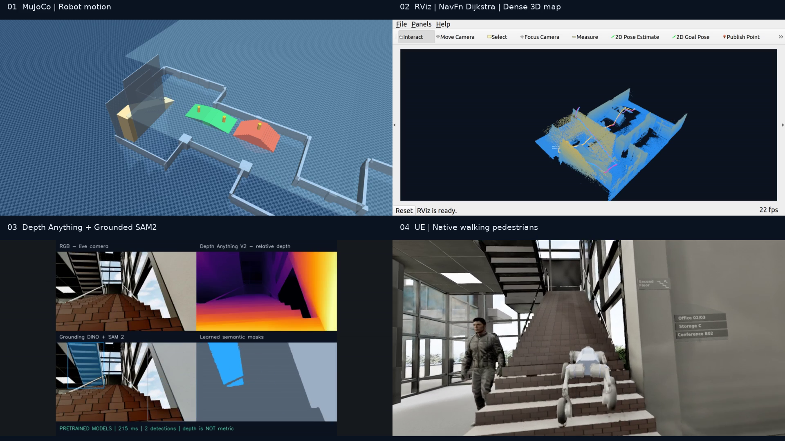
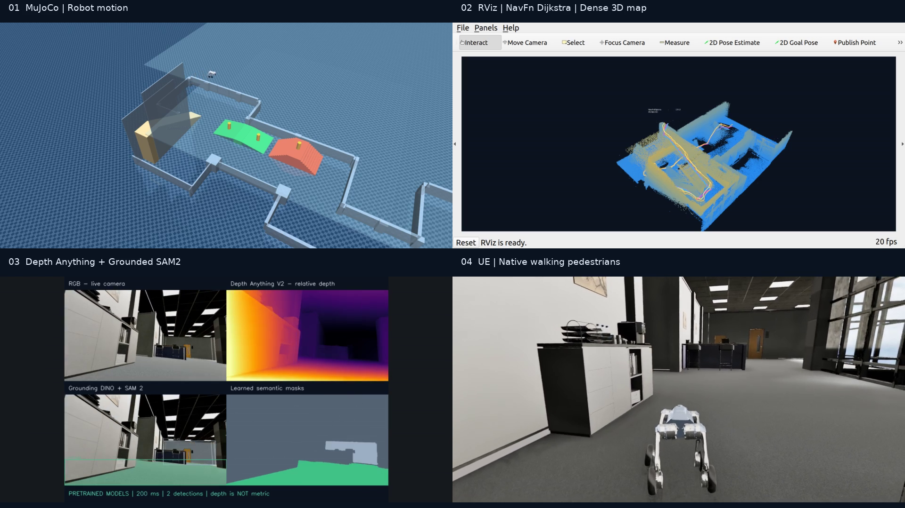
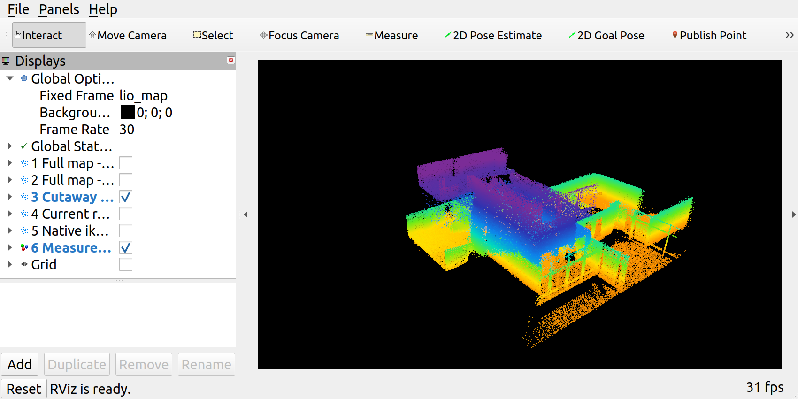

# 仿真截图、时间点与地图来源

所有图片均复制自本机已有仿真录像或建图输出。没有生成或补绘机器人、障碍物、点云和检测结果。文件摘要可与 [来源清单](../source_manifest.json)核对。

## 四分屏连续导航

画面位置固定：**左上 MuJoCo / 右上 RViz / 左下 RGB-D 模型 / 右下 UE 原生行人**。MuJoCo 镜像显示机器人与静态地形，行人人体及其激光命中发生在 UE 侧。以下时间相对于每轮独立视频的开头，不是合并视频时间。

| 阶段 | NavFn Dijkstra | Smac 2D A* |
|---|---|---|
| 动态行人通行 | [48.858 s](simulation/dijkstra_pedestrians.png) | [48.343 s](simulation/astar_pedestrians.png) |
| 原生楼梯段 | [104.223 s](simulation/dijkstra_stairs.png) | [101.458 s](simulation/astar_stairs.png) |
| 接近任务结束 | [160.608 s](simulation/dijkstra_goal.png) | [156.945 s](simulation/astar_goal.png) |

| Dijkstra · 楼梯 | Smac A* · 楼梯 |
|---|---|
|  |  |
| Dijkstra · 终点阶段 | Smac A* · 终点阶段 |
|  |  |

两段原始视频为 1920×1080、20 fps，分别长 174.7 s 与 164.7 s，完整合并视频为 339.4 s，A* 段从 174.7 s 开始。关键帧由控制事件时间减去录像启动时间选择，存在帧时钟取整；“终点阶段”关键帧本身不替代 [Dijkstra 最终状态](reports/dijkstra/course/result.json) / [A* 最终状态](reports/astar/course/result.json)。

原视频目录（本机）：

```text
/home/unitree/Go2w+cosmos3Nav/matrix_go2w_office_20260916/artifacts/
├── global_navfn_final2_20261001/go2w_four_screen_demo.mp4
├── global_smac_final2_20261001/go2w_four_screen_demo.mp4
└── global_compare_20261001/demo_final/officeworld_two_global_planners_demo.mp4
```

[原始导出清单](reports/demo_manifest.json)保留精确时间、源视频绝对路径、历史 PCD 统计和验证结果；其中 PCD 已于本次发布前清理，不提供失效的下载链接。两个 [verification.json](reports/astar/verification.json)记载当时全片解码检查，本次没有重录视频或重做两轮运动。

## 点云与地图

| 图片 | 实际含义 | 记录与显示参数 |
|---|---|---|
| [10 月 1 日最终 RViz](simulation/rviz_dense_map.png) | 保存运行时的点云与路径画面 | 10 月 1 日仿真，旧剖切显示 |
| [10 月 2 日俯视](mapping/rviz_lio_review.png) | 从 NPZ 重播的实际 RViz 画面 | 图中勾选的是建筑剖切与抽样位姿节点 |
| [10 月 2 日侧视](mapping/rviz_spectral_side.png) | 同一记录的高度配色与侧视 | 橙/黄 → 绿/青 → 蓝/紫表示高度，不是类别 |
| [三视图](mapping/lio_map_three_views.png) | 保存测点的完整俯视、三维剖切和走廊高度剖面 | 从全图抽样绘图；没有补造表面 |
| [原生 ikd-Tree 地图](mapping/native_ikd_map.png) | 9 月 16 日 bag 在新地图出口上的回放结果 | 完整 NPZ 567,242 点，图中视区 353,289 点；独立原点 |



归档三视图/旧截图的轨迹节点比当前代码密集；新源码按 6 m 采样。归档图记录其生成时的显示效果，不作为当前节点数量的证据。

## 中文单窗口与三种表示

这组使用 **2026-09-19 的校正地图**，截图保存于 9 月 23 日。三种表示共享当时的 1,858,378 个测点坐标，与本页上方 10 月 1 日记录不同。

| 场景图 | 中文语义框 | 纯点云 |
|---|---|---|
|  |  |  |

[融合视图](semantic_20260923/04_combined.png) · [中文标签近景](semantic_20260923/08_chinese_boxes_no_question.png) · [当时的校验](semantic_20260923/validation.json)

Box 名称直接翻译算法类别，编号和空间锚点保留。Graph 包含测量/结构候选，具体来源与已知层高校正先验见 [原地图说明](../../semantic_hierarchy/docs/fresh_semantics.md)。
